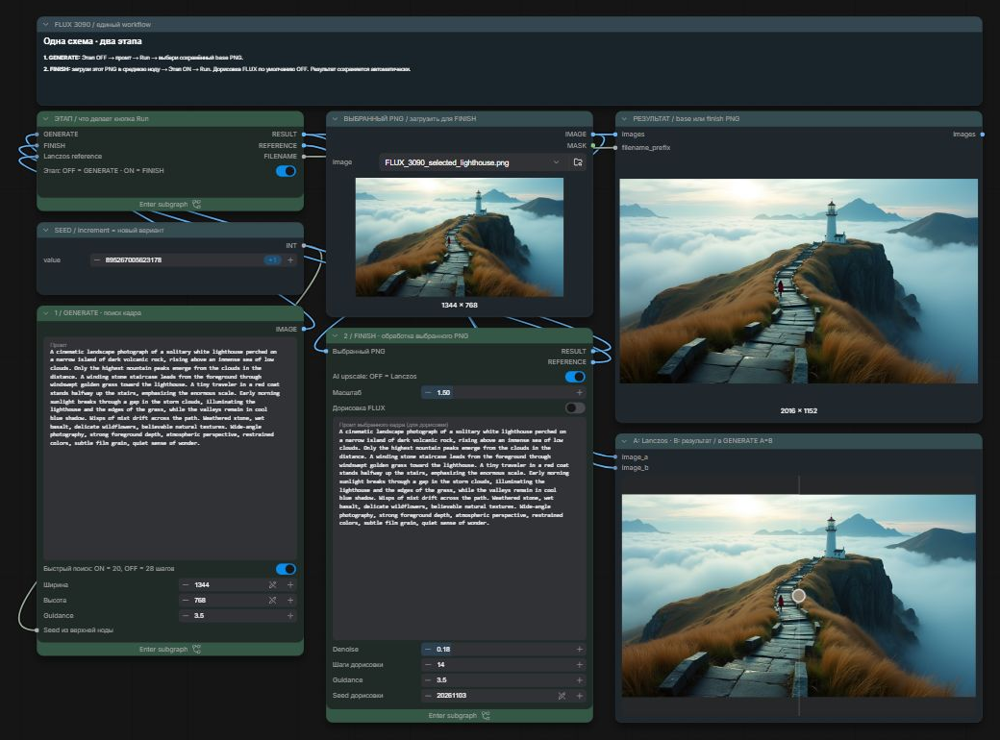

# FLUX 3090 Studio

**Один файл workflow для ComfyUI Desktop:**
[FLUX_3090_STUDIO.json](FLUX_3090_STUDIO.json).
Внутри уже собраны **GENERATE и FINISH на одном холсте**.
Переключатель **ЭТАП** выбирает, что делает кнопка Run:

| ЭТАП | Действие Run |
| --- | --- |
| **OFF — GENERATE** | Создаёт новый кадр из промта, сохраняет `base_….png` |
| **ON — FINISH** | Обрабатывает выбранный PNG, сохраняет `finish_….png` |

Проверено на **RTX 3090 24 ГБ / RAM 32 ГБ**. Штатные ноды ComfyUI,
без custom nodes. Модели скачиваются отдельно; если они уже установлены,
повторно скачивать их не нужно.

## Первый запуск

1. Скачай **только [FLUX_3090_STUDIO.json](FLUX_3090_STUDIO.json)**:
   открой файл на GitHub и нажми **Download raw file** справа сверху.
   Можно также скачать весь репозиторий через **Code → Download ZIP**.
2. Открой ComfyUI Desktop. Сохрани свою текущую схему, если она нужна.
3. **Перетащи скачанный `FLUX_3090_STUDIO.json` из Проводника на холст ComfyUI.**
   Либо выбери **меню ComfyUI → File → Open** и укажи этот файл.
   Все блоки появятся сразу. Другие JSON и отдельные вкладки не нужны.
4. В **ЭТАП** оставь переключатель **OFF — GENERATE**. В левом блоке напиши промт,
   оставь `1344 × 768`, быстрый поиск ON, seed increment. Нажми **Run**.
5. Выбери удачный сохранённый `base_….png`. В средней верхней ноде
   **ВЫБРАННЫЙ PNG / загрузить для FINISH** нажми значок папки и выбери этот файл.
6. В **ЭТАП** включи **ON — FINISH**. В блоке FINISH оставь AI upscale ON,
   масштаб 1.5, дорисовку OFF. Нажми **Run**.
7. Финальный `finish_….png` автоматически сохранится в `output/FLUX_3090_v2/`
   твоей установки ComfyUI. Превью результата и A/B находятся справа.

**При переносе на новый ПК:** сначала установи [модели](docs/installation.md).
Если в ноде выбранного PNG нет файла с маяком, перед первым Run выбери любой PNG
с диска либо [пример из комплекта](examples/FLUX_3090_selected_lighthouse.png).
ComfyUI проверяет наличие этого файла даже в этапе GENERATE. После поиска
кадра замени его на понравившийся `base_….png`. В исходной проверенной установке
файл с маяком уже находится в input.

Для работы A/B включи **Nodes 2.0**. В режиме GENERATE стороны A/B совпадают;
в режиме FINISH слева Lanczos, справа выбранная обработка.
Веди курсор по картинке без зажатой кнопки мыши.

## Подробности

- [Пошаговый гайд](docs/guide.md): выбор кадра, загрузка PNG, обычное увеличение и Refine.
- [Установка и модели](docs/installation.md), [решение проблем](docs/troubleshooting.md).
- [Замеры и проверка переключателя](docs/benchmarks.md).
- [Промт с маяком](prompts/lighthouse.txt),
  [исходник](examples/FLUX_3090_selected_lighthouse.png),
  [увеличение](examples/example_upscale.png), [дорисовка](examples/example_refine.png).

При ON — FINISH ветка GENERATE не выполняется, даже если её seed или промт
изменились. Выбранный файл не заменяется новой генерацией.
Промт дорисовки задаётся отдельно — используй промт выбранного кадра.

Для дорисовки начни с **14 шагов / denoise 0.18 / guidance 3.5**.
Она может менять мелкие предметы, поэтому по умолчанию выключена.

Ориентиры на проверенном ПК после прогрева: генерация 20/28 шагов — около
30/42 секунд, Real-ESRGAN без FLUX — около 2.3 секунды, с дорисовкой — около
56 секунд. Это прежние одиночные замеры тех же вычислительных блоков;
подробности и влияние кеша описаны в [измерениях](docs/benchmarks.md).

## Лицензии и источники

Авторские схемы JSON и текст документации распространяются по [MIT](LICENSE).
Эта лицензия не перелицензирует ComfyUI, веса моделей, интерфейс на скриншотах
или сгенерированные изображения. Веса в репозиторий не включены.

- [Официальный пример FLUX для ComfyUI](https://docs.comfy.org/tutorials/flux/flux-1-text-to-image).
- [FLUX.1-dev: оригинальная модель и условия использования](https://huggingface.co/black-forest-labs/FLUX.1-dev).
- [Файлы модели от Comfy-Org](https://huggingface.co/Comfy-Org/Flux-1-Dev).
- [Real-ESRGAN x2plus, официальный релиз](https://github.com/xinntao/Real-ESRGAN/releases/tag/v0.2.1).
