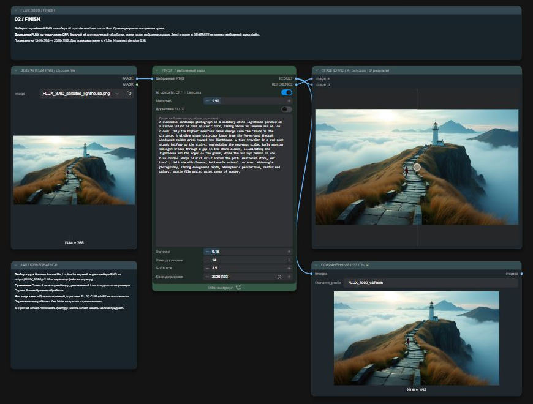

# FLUX 3090 Studio

Две готовые схемы для **FLUX.1-dev в ComfyUI Desktop**: сначала найти композицию,
затем обработать выбранный PNG. Проверено на **RTX 3090 24 ГБ и 32 ГБ RAM**.

**GENERATE → выбрать сохранённый PNG → FINISH → финальный PNG**

## Что входит

- [GENERATE.json](workflows/FLUX_3090_v2_GENERATE.json): промт, размеры, seed,
  быстрый поиск в 20 шагов и режим в 28 шагов.
- [FINISH.json](workflows/FLUX_3090_v2_FINISH.json): выбранный файл, Real-ESRGAN
  или Lanczos, увеличение ×1.5, необязательная дорисовка FLUX и сравнение A/B.
- [Пошаговая инструкция со скриншотами](docs/guide.md).
- [Установка и модели](docs/installation.md), [решение проблем](docs/troubleshooting.md)
  и [результаты измерений](docs/benchmarks.md).
- [Исходный PNG](examples/FLUX_3090_selected_lighthouse.png),
  [увеличение без FLUX](examples/example_upscale.png),
  [увеличение с дорисовкой](examples/example_refine.png) и [промт](prompts/lighthouse.txt).

Используются встроенные ноды ComfyUI, включая native subgraphs и ImageCompare.
Custom nodes устанавливать не требуется. Веса моделей скачиваются отдельно.

## Первый запуск

1. Установи [модели](docs/installation.md) и включи **Nodes 2.0** для сравнения A/B.
2. Скачай репозиторий: **Code → Download ZIP**, распакуй архив.
3. Открой каждый JSON из `workflows/` в отдельной вкладке ComfyUI и сохрани схемы.
4. В **GENERATE** напиши промт, оставь `1344 × 768`, `guidance 3.5`,
   быстрый поиск **ON**, seed **increment**, batch **1**. Нажми **Run** несколько раз.
5. Выбери удачный `base_….png` из `output/FLUX_3090_v2/`.
6. В **FINISH**, в ноде **ВЫБРАННЫЙ PNG / choose file**, нажми значок папки/загрузки
   справа от имени файла и выбери этот PNG. Дождись его превью слева.
7. Оставь **AI upscale ON**, **масштаб 1.5**, **Дорисовка FLUX OFF**. Нажми **Run**.
8. Проверь сравнение справа; результат уже сохранён как
   `output/FLUX_3090_v2/finish_….png`.

Для первого теста можно загрузить в FINISH файл
`examples/FLUX_3090_selected_lighthouse.png`. Другой вариант — скопировать его
в `input/` ComfyUI с тем же именем: оно уже выбрано в JSON.

**Переноси сам PNG в ноду загрузки FINISH.** Если бросить PNG на пустой холст,
ComfyUI может открыть workflow из метаданных этого PNG вместо выбора изображения.

## Когда включать дорисовку

Сначала оцени обычное увеличение. Если хочется изменить или усилить мелкие детали,
включи **Дорисовка FLUX**, вставь исходный промт выбранного кадра и начни с
**14 шагов / denoise 0.18 / guidance 3.5**. Дорисовка может менять траву, ступени,
силуэты людей и другие небольшие элементы; это творческий режим обработки.

## Проверено на RTX 3090

| Режим | Размер результата | Время одного проверочного запуска |
| --- | --- | ---: |
| GENERATE, 20 шагов | 1344 × 768 | около 30 с |
| GENERATE, 28 шагов | 1344 × 768 | около 42 с |
| FINISH, Real-ESRGAN, без FLUX | 2016 × 1152 | около 2.3 с |
| FINISH, Real-ESRGAN + FLUX refine | 2016 × 1152 | около 56 с |

Замеры относятся к одному пейзажу и прогретой установке; первый запуск с загрузкой
весов дольше. Подробности и ограничения — в [benchmarks](docs/benchmarks.md).

## Лицензии и источники

Авторские схемы JSON и текст документации распространяются по [MIT](LICENSE).
Эта лицензия не перелицензирует ComfyUI, веса моделей, интерфейс на скриншотах
или сгенерированные изображения. Веса в репозиторий не включены.

- [Официальный пример FLUX для ComfyUI](https://docs.comfy.org/tutorials/flux/flux-1-text-to-image).
- [FLUX.1-dev: оригинальная модель и условия использования](https://huggingface.co/black-forest-labs/FLUX.1-dev).
- [Файлы модели от Comfy-Org](https://huggingface.co/Comfy-Org/Flux-1-Dev).
- [Real-ESRGAN x2plus, официальный релиз](https://github.com/xinntao/Real-ESRGAN/releases/tag/v0.2.1).
