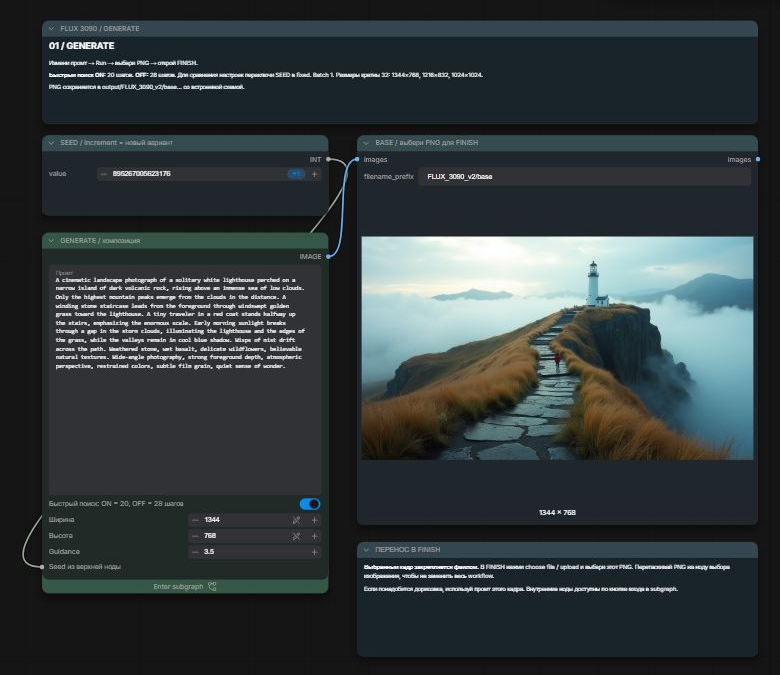
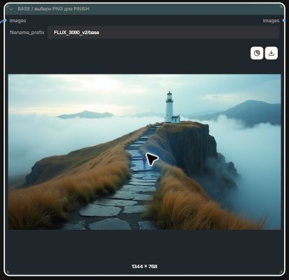
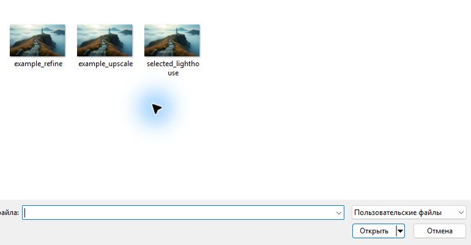
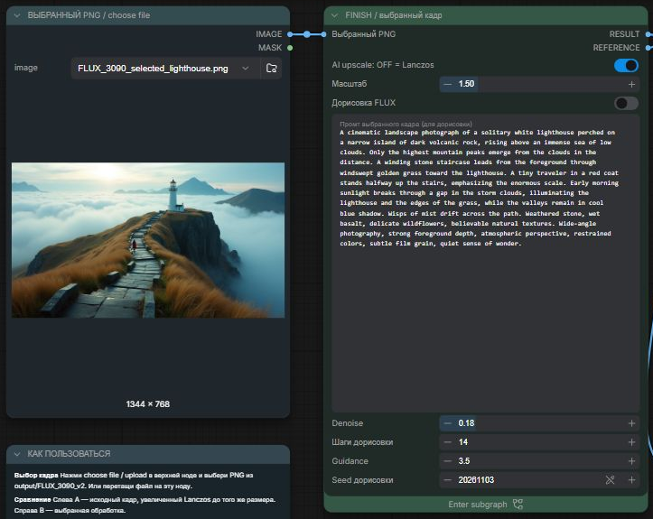
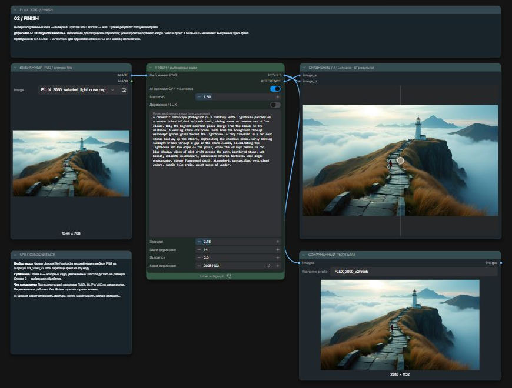

# От промта до финального PNG

GENERATE и FINISH — две независимые вкладки. Между ними передаётся **сохранённый
файл изображения**. Новые промты и seed в GENERATE не меняют файл, уже выбранный
в FINISH.

## 1. Найти композицию в GENERATE

Открой вкладку **FLUX_3090_v2_GENERATE**. Для обычной работы достаточно внешних
элементов управления; внутренние ноды доступны через **Enter subgraph**.



1. В поле **Промт** опиши сюжет, композицию, свет и фактуру.
   Для проверки есть [готовый промт с маяком](../prompts/lighthouse.txt).
2. Поставь размеры **1344 × 768** для широкого пейзажа. Другие стартовые форматы:
   **1216 × 832** или **1024 × 1024**. В этих пресетах размеры кратны 32.
3. Оставь **Guidance 3.5** и **Batch Count 1**.
4. Включи **Быстрый поиск**: **ON = 20 шагов**, **OFF = 28 шагов**.
5. В ноде **SEED** оставь режим **increment**. Переключатель режима находится
   справа в строке значения; в текущем интерфейсе increment отмечен значком **+1**.
6. Нажми синюю кнопку **Run** сверху. Дождись завершения текущего запуска.
7. Оцени картинку в ноде **BASE / выбери PNG для FINISH**. Для следующего варианта
   снова нажми Run; при increment seed изменяется на +1.

На этой RTX 3090 поиск в 20 шагов занимал около 30 секунд после прогрева.
Не нужно сразу включать дорисовку или увеличивать разрешение для каждого варианта.

## 2. Выбрать удачный кадр

Сначала оцени крупную композицию: положение главного объекта, свет, горизонт,
глубину и читаемость сцены. Затем посмотри на мелкие объекты — человека, лестницу,
геометрию маяка. Увеличение не исправляет само по себе неудачную композицию.

Каждый успешный запуск GENERATE автоматически сохраняет отдельный PNG:

```text
output/FLUX_3090_v2/base_00001_.png
output/FLUX_3090_v2/base_00002_.png
…
```

Это подпапка **output твоей установки ComfyUI**. У Desktop корневая папка данных
зависит от выбранной установки; она может называться `ComfyUI-Shared`.
Если путь неизвестен, можно скачать выбранное изображение прямо из превью.

1. Наведи курсор на изображение в **BASE** или щёлкни по нему.
2. В правой верхней части превью появится кнопка **Download image** — стрелка вниз.
3. Сохрани PNG в удобную папку. Этот файл можно сразу загрузить в FINISH.
4. Для сравнения нескольких результатов открой сохранённые PNG в просмотрщике
   изображений и выбери один файл. Номер в имени помогает не перепутать варианты.



### Как повторить именно понравившуюся генерацию

Режим **increment** меняет поле seed после запуска. Видимое сейчас число может
уже относиться к следующему кадру. Для точного повтора используй параметры из
истории выполненного задания или workflow, сохранённый внутри исходного PNG.
Открой такой PNG **в отдельной вкладке**, проверь фактический seed задания,
поставь режим **fixed** и сохрани прежние промт, размеры и число шагов.

Если нужно сразу обрабатывать понравившийся кадр, seed восстанавливать не требуется:
достаточно выбрать его PNG в FINISH.

Отключение быстрого поиска меняет число шагов с 20 на 28. Даже при том же seed
детали могут измениться. Сохрани оба PNG и оцени результат, прежде чем выбрать файл.

## 3. Перенести PNG в FINISH

1. Переключись на вкладку **FLUX_3090_v2_FINISH**.
2. Найди слева ноду **ВЫБРАННЫЙ PNG / choose file**.
3. Нажми кнопку загрузки — значок папки справа от имени файла.
   В других версиях интерфейса она может называться **choose file to upload**.
4. В диалоге выбери понравившийся `base_….png` и нажми **Открыть**.
   Можно выбрать PNG из `output/FLUX_3090_v2/` или его скачанную копию.
5. Проверь имя файла, превью и размеры **именно в левой ноде**.
   Там должен быть выбранный кадр, а не прежний образец с маяком.



Имя файла с маленькой стрелкой открывает список уже загруженных изображений.
Кнопка папки справа позволяет выбрать новый файл с диска. Загрузка в локальный
ComfyUI создаёт входную копию изображения для обработки.

Файл также можно перетащить **на ноду загрузки изображения**. Если бросить PNG
на пустой холст, может загрузиться схема из его метаданных. Поэтому для первого
раза удобнее кнопка папки и обычный диалог выбора файла.

## 4. Получить увеличение без дорисовки

В центральной ноде **FINISH / выбранный кадр** выставь:

| Поле | Стартовое значение | Действие |
| --- | --- | --- |
| AI upscale | ON | Real-ESRGAN x2, затем приведение к выбранному масштабу |
| Масштаб | 1.5 | Из 1344 × 768 получится 2016 × 1152 |
| Дорисовка FLUX | OFF | Ветка FLUX, CLIP и VAE не выполняется |



1. Нажми **Run** сверху и дождись завершения.
2. Слева останется входной файл; справа обновятся **СРАВНЕНИЕ** и
   **СОХРАНЁННЫЙ РЕЗУЛЬТАТ**.
3. В блоке сравнения веди курсор по самой картинке **без зажатой кнопки мыши**.
   Граница следует за курсором. Если тащить с зажатой кнопкой, можно переместить ноду.
4. **A слева** — исходник, увеличенный Lanczos. **B справа** — выбранная обработка.
   Обе картинки имеют одинаковые размеры, так что сравнение не подменяется
   разницей в масштабе.

При выключенной дорисовке поля промта, denoise, шагов, guidance и seed не влияют
на изображение. Они понадобятся, только если включить дорисовку.

Для проверки обычного масштабирования выключи **AI upscale** и снова нажми Run:
результатом будет Lanczos. Если при этом дорисовка тоже OFF, стороны A и B совпадут —
это ожидаемое поведение. Real-ESRGAN может сглаживать фактуру, поэтому сравни
облака, траву и камни при близком просмотре.

## 5. При желании добавить детали через FLUX

Сначала сохрани и оцени вариант без дорисовки. Затем:

1. Включи **Дорисовка FLUX**.
2. Вставь **исходный промт выбранного PNG** в поле
   **Промт выбранного кадра (для дорисовки)**. Промт из GENERATE автоматически
   между вкладками не переносится.
3. Начни с **denoise 0.18**, **14 шагов**, **guidance 3.5**, масштаба **1.5**.
4. Зафиксируй **seed дорисовки** в режиме **fixed**, если сравниваешь настройки.
   Он независим от seed генерации исходного PNG.
5. Нажми **Run**. При проверке этого режима обработка заняла около 56 секунд.
6. Проверь, не изменились ли лицо/силуэт человека, ступени, окна и очертания объектов.

Refine заново синтезирует часть деталей. Если он меняет сцену сильнее желаемого,
попробуй меньший denoise, например **0.10–0.15**, либо верни дорисовку в OFF.
Этот диапазон — отправная точка для эксперимента; в замерах проверено 0.18.
Повторный Run обрабатывает тот же выбранный входной PNG, а не предыдущий результат.

## 6. Забрать финальную картинку

Результат уже записан на диск после успешного запуска:

```text
output/FLUX_3090_v2/finish_00001_.png
output/FLUX_3090_v2/finish_00002_.png
…
```

Открой последний нужный файл в этой папке либо используй **Download image**
в ноде **СОХРАНЁННЫЙ РЕЗУЛЬТАТ**. PNG сохраняется с параметрами и workflow
в метаданных. Не пересохраняй его через мессенджер или в JPEG, если хочешь
сохранить эти данные для воспроизведения.



Если хочешь отдельно хранить результаты двух режимов, скопируй понравившиеся PNG
под понятными именами, например `lighthouse_upscale.png` и `lighthouse_refine.png`.
Смена имени файла не меняет сами пиксели или встроенные PNG-метаданные.
